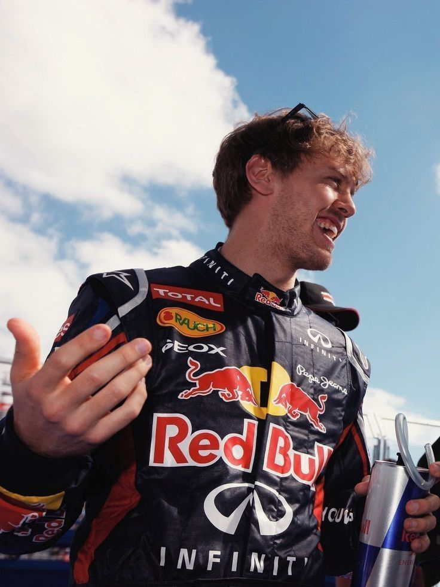
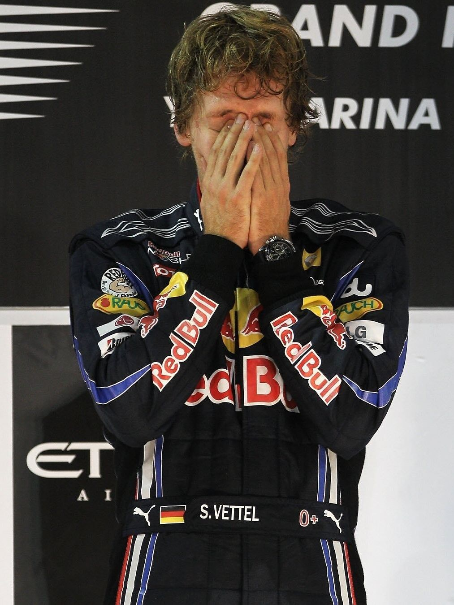
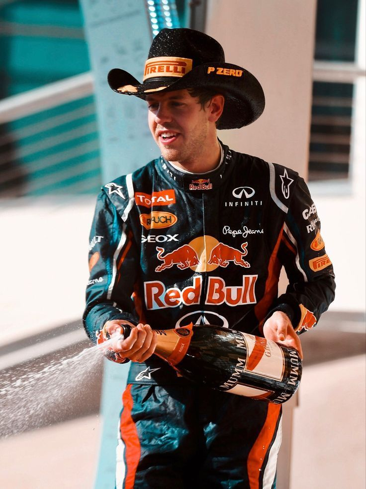

 
  
 

 

 

 
  

  
  

  

 

 
 ⋅⋆ ──  ──── ⋆⋅𖤓⋅⋆ ────  ── ⋆⋅ 
  
[ᴀᴛᴀ](https://fishjam.atabook.org/) ⋆ [ꜱᴛʀᴀᴡ](https://fishjam.straw.page/) ⋆ [ɢᴜɴꜱ](https://guns.lol/fishjam) 

  

<!--
**INSPECTOR-SEB/INSPECTOR-SEB** is a ✨ _special_ ✨ repository because its `README.md` (this file) appears on your GitHub profile.

   

Here are some ideas to get you started:

- 🔭 I’m currently working on ...
- 🌱 I’m currently learning ...
- 👯 I’m looking to collaborate on ...
- 🤔 I’m looking for help with ...
- 💬 Ask me about ...
- 📫 How to reach me: ...
- 😄 Pronouns: ...
- ⚡ Fun fact: ...
-->
